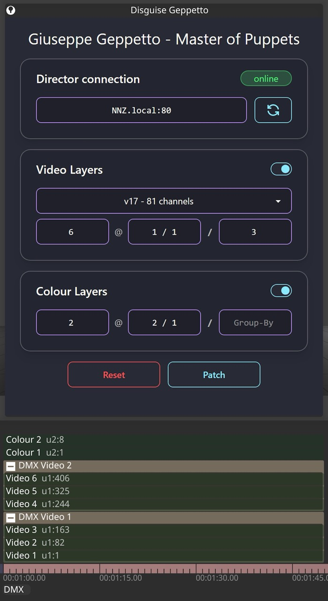
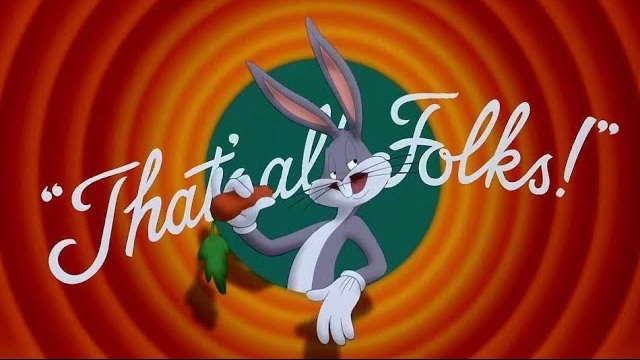

# Giuseppe Geppetto - Master of Disguise Sockpuppets

## Simple DMX autopatcher designed to create pancake stack of Sockpuppet layers

## I't a pet project under MIT - no strings attached

Stack: Vite/Svelte/Daisy

##

